# 13. Карта ассоциаций и зависимостей бизнес-функций ДИТ.Калькулятор

> Составлена по результатам исследования **всех Markdown-файлов репозитория**: консолидированный SRS (`01`–`12`, `README`) и 68 первичных бизнес-постановок (`by_bp/*.md`, включая `INDEX.md` и обогащённые карточки `by_bp/enriched/*`).
> Основа — фактические связи из файлов `09` (матрицы трассировки, §9.1 и §9.3), `03` (FR), `04` (бизнес-правила), `05` (use cases), `11` (реестр функций системы), `07` (конфликты C-1…C-10). Домыслы не добавлялись: тип каждой связи подтверждён источником.

---

## 13.1. Приложение в одном предложении

**ДИТ.Калькулятор** — сервис платформы **ДИТ.Интеллект** для расчёта стоимости работ (**РСЗ**) по заявкам/работам в рамках государственных контрактов (**ГК**) и служебных заданий (**СЗ**) по методике **3-Р**, ведения НСИ, формирования отчётной документации (**ЧТЗ, ПЗ, ПМИ, ПОЗ, ОИО**) и сопровождения согласования между аналитиками ДИТ и подрядчиков.

## 13.2. Домены бизнес-функций (8 модулей, из Файла 03)

| # | Домен | FR | Ключевые сущности | Основные роли |
|---|---|---|---|---|
| D1 | **НСИ** (контракты, закупки, системы) | FR-NSI-01…13 | Закупка, ГК, Этап ГК, Система, Подсистема, Проект, Тип работ | Администратор, Администратор НСИ, РП |
| D2 | **Работы / Заявки** | FR-WORK-01…08 | Работа/Заявка, US (задача МосТрек), период работы, размер команды | Аналитик Подрядчика, РП ДИТ |
| D3 | **Расчёты стоимости (РСЗ)** | FR-CALC-01…14 | РСЗ, ФОИ, Итерация, БП (в Конструкторе), замечания | Аналитик Подрядчика, Аналитик ДИТ, Администратор |
| D4 | **Отчётная документация (ОД)** | FR-DOC-01…13 | ЧТЗ, ПЗ, ПМИ, ПОЗ, ОИО, децимальный номер, печатные формы | Аналитик Подрядчика, Аналитик ДИТ, Пользователь СПУР |
| D5 | **Служебные задания / Внутренние работы** | FR-SZ-01…04 | СЗ, Этап СЗ, Внутренняя работа | Администратор НСИ, РП |
| D6 | **Аналитика и планирование** | FR-AN-01…04 | Дашборды, календарные планы, диаграммы загрузки | РП, руководители направлений/продуктов |
| D7 | **База знаний и помощь** | FR-KB-01…03 | Статьи БЗ, онбординг, чат-бот ДИТ.Вопрос | Все пользователи, Администратор |
| D8 | **UX / интеграции / прочее** | FR-UX-01…04, FR-INT-01…03, FR-MISC-01 | Реестры (выравнивание, пагинация), адаптивная вёрстка; внешние системы | Все роли |

---

## 13.3. Граф бизнес-функций (Mermaid)

```mermaid
graph TD
    subgraph D8u["UX-контур (сквозной)"]
        UX1[FR-UX-01 Адаптивный интерфейс]
        UX2[FR-UX-02 Выравнивание реестров]
        UX3[FR-UX-03 Подсказки в индикаторах]
        UX4[FR-UX-04 Пагинация — паттерн во многих БП]
    end

    subgraph D1["D1. НСИ"]
        NSI01[FR-NSI-01 Реестр Закупки]
        NSI02[FR-NSI-02 Статусные модели Закупка/ГК/Этап/Работа]
        NSI03[FR-NSI-03 Заведение ГК v2]
        NSI04[FR-NSI-04 Переход к ГК по клику]
        NSI05[FR-NSI-05 Реестр Системы + ДИТ.НСИ]
        NSI06[FR-NSI-06 Объединённый реестр Системы+Проекты]
        NSI07[FR-NSI-07 Карточка Проект]
        NSI08[FR-NSI-08 Справочник Тип работ]
        NSI09[FR-NSI-09 Реестр подсистем, коэффициенты 3-Р]
        NSI10[FR-NSI-10 ФТ развитие/рефакторинг]
        NSI11[FR-NSI-11 Фильтрация ФОИ low-code/методика]
        NSI12[FR-NSI-12 Дорожная карта в Системе]
        NSI13[FR-NSI-13 Вкладка Бюджеты и закупки в Системе]
    end

    subgraph INT["Внешние системы (FR-INT)"]
        I01[FR-INT-01 СПУ]
        I02[FR-INT-02 Тех. портал]
        I03[FR-INT-03 ДИТ.Мета]
        SPUR[FR-DOC-13 СПУР]
        JIRA[Jira / МосТрек]
        TG[Telegram API]
        CONF[Confluence]
    end

    subgraph D2["D2. Работы/Заявки"]
        W01[FR-WORK-01 Задачи заявки]
        W02[FR-WORK-02 Проверка US на дубли]
        W03[FR-WORK-03 Запрет дублей наименований работ]
        W04[FR-WORK-04 Периоды работ ≤ срок этапа ГК]
        W05[FR-WORK-05 Кликабельные US]
        W06[FR-WORK-06 Переходы между ЭФ]
        W07[FR-WORK-07 Интерфейс расчёта для РП]
        W08[FR-WORK-08 Размер команды]
    end

    subgraph D3["D3. Расчёты (РСЗ)"]
        C01[FR-CALC-01 Формирование РСЗ v2]
        C02[FR-CALC-02 Импорт ФОИ из Excel]
        C03[FR-CALC-03 In-line таблица ФОИ]
        C04[FR-CALC-04 Предзаполнение БП в РСЗ]
        C05[FR-CALC-05 Замена ФОИ из НМЦК]
        C06[FR-CALC-06 Обновление ОД при повторном копировании]
        C07[FR-CALC-07 Проверка описания ФОИ ≥300 симв.]
        C08[FR-CALC-08 Статус ФОИ фикс. стоимости]
        C09[FR-CALC-09 Перепривязка ФОИ к итерации]
        C10[FR-CALC-10 Статусы ФОИ на согласовании]
        C11[FR-CALC-11 Конструктор РСЗ]
        C12[FR-CALC-12 Справочник замечаний]
        C13[FR-CALC-13 Выгрузка замечаний]
        C14[FR-CALC-14 Проверка заполненности НСИ]
    end

    subgraph D4["D4. Отчётная документация"]
        DOC01[FR-DOC-01 Единый вид пустых данных]
        DOC02[FR-DOC-02 Нумерация разделов]
        DOC03[FR-DOC-03 Децимальный номер]
        DOC04[FR-DOC-04 Шаблон ПЗ]
        DOC05[FR-DOC-05 Исключение п. ТЗ из ПОЗ]
        DOC06[FR-DOC-06 Автоподтягивание БП в ПЗ/ЧТЗ]
        DOC07[FR-DOC-07 Комплектная выгрузка ЧТЗ]
        DOC08[FR-DOC-08 Трудозатраты по US в ПОЗ]
        DOC09[FR-DOC-09 НДС 20/22% в ПОЗ]
        DOC10[FR-DOC-10 Реестр целевых показателей]
        DOC11[FR-DOC-11 Смена организации заказчика]
        DOC12[FR-DOC-12 Раздел Документы]
    end

    subgraph D5["D5. СЗ / Внутренние работы"]
        SZ01[FR-SZ-01 Карточка СЗ]
        SZ02[FR-SZ-02 Статусные модели СЗ/Этап СЗ/Внутр.работа]
        SZ03[FR-SZ-03 Реестр Внутренние работы]
        SZ04[FR-SZ-04 Календарный план СЗ]
    end

    subgraph D6["D6. Аналитика"]
        AN01[FR-AN-01 Обзор текущих показателей]
        AN02[FR-AN-02 Календарные планы ГК/СЗ]
        AN03[FR-AN-03 Дашборд Бюджеты и закупки]
        AN04[FR-AN-04 Диаграммы сотрудников]
    end

    subgraph D7["D7. База знаний"]
        KB01[FR-KB-01 Модуль БЗ MVP1]
        KB02[FR-KB-02 База Знаний Калькулятора]
        KB03[FR-KB-03 Раздел Помощь]
    end

    %% === зависимости (из Файла 09 §9.3 и Файла 03) ===
    NSI01 -->|автогенерирует ГК «Черновик»| NSI03
    I01 -->|питает поля ГК| NSI03
    I02 -->|наполняет| NSI05
    I02 -->|наполняет| NSI09
    NSI07 -.->|объединяется в| NSI06
    NSI05 -.->|объединяется в| NSI06
    NSI10 -->|сверка сумм ФТ контролирует| C01
    NSI11 -->|фильтрует справочник ФОИ для| C01
    NSI09 -->|коэффициенты 3-Р нужны для| C01
    C14 ==>|ПРЕДУСЛОВИЕ: блокирует расчёт при неполной НСИ| C01
    C01 --- C02 & C03 & C04 & C11
    C05 -->|результат попадает в| C06
    C06 -->|обновляет данные| DOC12
    C09 <-.->|КОНФЛИКТ C-1: границы окна статусов| C10
    W02 <-.->|ДУБЛЬ C-2| C10
    W01 -->|задачи US для проверки| W02
    JIRA -->|задачи US| W01
    JIRA -->|дорожные карты| NSI12
    W04 -->|граница дат| NSI02
    W08 -->|зависит от признака рефакторинга функций| C01
    NSI10 -.->|признак развитие/рефакторинг| W08
    C12 -->|замечания| C13
    C01 -->|замечания к РСЗ| C12
    C01 ==>|формирование| DOC12
    DOC06 -->|подтягивает БП из| C04
    DOC06 -->|в ПЗ/ЧТЗ| DOC04
    DOC08 -->|декомпозиция трудозатрат в| DOC05
    DOC09 <-.->|КОНФЛИКТ C-5: два правила ставки| DOC09
    I03 -->|структуры БД → шаблоны ОИО| DOC12
    SPUR -->|создание/согласование шаблонов| DOC12
    SPUR -->|использует статусы| NSI02
    DOC07 -->|архивом выводит| DOC04
    DOC11 -->|согласующие на титульные листы| DOC12
    SZ01 -->|связан с реестром ГК| NSI03
    SZ02 ==>|СТРОГО ПОСЛЕ статусных моделей| NSI02
    SZ03 -->|работы внутри| SZ01
    SZ04 -->|план по| SZ01
    AN02 -->|планы ГК/СЗ читают| NSI02
    AN02 --> SZ04
    NSI13 ==>|реализуется ПОСЛЕ контура СЗ| SZ01
    NSI13 --> AN03
    I01 -->|финансы по годам/этапам| AN03
    AN01 -->|показатели| AN03
    AN04 -->|загрузка команды из| W08
    KB01 <-.->|КОНКУРЕНЦИЯ C-9: два документа об одном модуле| KB02
    KB03 -->|чат-бот отвечает по статьям| KB02
    TG -->|новости| MISC01[FR-MISC-01 Виджет ТГ]
    NSI04 & W05 & W06 ==>|навигационный контур UC-18| C01
    UX1 & UX2 & UX3 & UX4 -.->|сквозные, применяются ко всем реестрам и ЭФ| D1 & D2 & D3 & D4 & D5 & D6
```



---

## 13.4. Ядро сквозного процесса: цепочка бизнес-функций

Главная нить приложения (из Файла 01 §1.3, цель 2):

```
Закупка → ГК → Этап ГК → Работа/Заявка → РСЗ (ФОИ/итерации) → Согласование → ОД (ЧТЗ/ПЗ/ПМИ/ПОЗ/ОИО) → СПУР/ЭДО → Оплата
   [D1]      [D1]     [D1]        [D2]            [D3]                  [D3/D1]              [D4]                    [D6]
```

| Шаг | Функции | Что от него зависит |
|---|---|---|
| 1. Заведение данных | FR-NSI-01 (Закупки), FR-NSI-03 (ГК v2), FR-INT-01/02 (СПУ, Тех.портал) | Закупка автогенерирует ГК «Черновик»; СПУ автозаполняет поля Редактора ГК |
| 2. Жизненный цикл | FR-NSI-02 (статусные модели), FR-SZ-02 (статусные модели СЗ) | Все переходы и блокировки проверок привязаны к статусам |
| 3. Подготовка НСИ к расчёту | FR-NSI-09/10/11 (коэффициенты, ФТ, low-code), FR-CALC-14 (проверка заполненности) | **Предусловие расчёта**: неполная НСИ блокирует формирование РСЗ |
| 4. Формирование расчёта | FR-CALC-01…11 (РСЗ, ФОИ, итерации, Конструктор) | Источник данных для всех документов и аналитики |
| 5. Согласование | FR-CALC-10, FR-CALC-12/13 (замечания), FR-DOC-13 (СПУР) | Статусы ФОИ/РСЗ определяют права редактирования |
| 6. Документация | FR-DOC-01…12 | Потребляет ФОИ, БП, US, НСИ, Мета; правила НДС/децимальных номеров |
| 7. Контроль и финансы | FR-AN-01…04, FR-NSI-13 | Агрегируют данные шагов 1–6 |

## 13.5. Матрица междоменных зависимостей (сводная)

| От ↓ / Зависит от → | D1 НСИ | D2 Работы | D3 Расчёты | D4 ОД | D5 СЗ | D6 Аналитика | D7 БЗ | D8 UX/INT |
|---|---|---|---|---|---|---|---|---|
| **D1 НСИ** | — | — | — | — | — | — | — | ← FR-INT-01/02/03 питают реестры |
| **D2 Работы** | ← статусы ГК/Этапа (NSI-02), справочник «Тип работ» (NSI-08) | — | ↔ US-проверки связаны со статусами ФОИ (WORK-02 ↔ CALC-10) | — | ← Внутренние работы — аналог Работ | — | — | ← навигация WORK-05/06 |
| **D3 Расчёты** | ← **предусловие NSI-09/10/11/CALC-14**; фильтрация NSI-11 | ← заявка/этап как контекст расчёта | — | → питает все документы | ← калькуляторский функционал повторяется в СЗ (CALC-05 ↔ SZ-01) | → показатели для AN-01 | — | ← импорт Excel (CALC-02) |
| **D4 ОД** | ← Organization/согласующие (DOC-11), НСИ-поля | ← задачи US → трудозатраты (DOC-08) | ← ФОИ/РСЗ как источник содержания | — | ← ОД формируется и по СЗ | — | — | ← ДИТ.Мета→ОИО, СПУР→шаблоны |
| **D5 СЗ** | ← боковое меню/реестры НСИ; **STATUS-модель строго после NSI-02** | ← реестр Внутренних работ подобен Работам | ← замена ФОИ (CALC-05) имеет аналог в СЗ | — | — | → Календарный план СЗ = часть AN-02; **NSI-13 после D5** | — | — |
| **D6 Аналитика** | ← бюджеты из карточек Системы (NSI-13), статусы этапов | ← «Размер команды» → диаграммы (AN-04) | ← готовность РСЗ/ОД как метрики | ← статусы готовности документов | ← план СЗ | — | — | ← данные СПУ (fin.), Тех.портала |
| **D7 БЗ** | — | — | — | — | — | — | — | ← Confluence, чат-бот ДИТ.Вопрос |
| **D8 UX** | применяется к реестрам D1 | к ЭФ D2 | к таблицам расчётов | к ПФ документов | к реестрам D5 | к дашбордам | к статьям БЗ | — |

Обозначения: «← X» — функция потребляет/зависит от X; «→» — отдаёт/блокирует; жирным — жёсткие предусловия из источников.

## 13.6. Ассоциации по объектам (сущность → функции)

| Объект | Создаётся/ведётся | Используется | Статусная модель |
|---|---|---|---|
| **Закупка** | FR-NSI-01 | автогенерация ГК (NSI-03), вкладка «Бюджеты и закупки» (NSI-13), дашборд (AN-03) | §4.1.1 (пробел C-10: статус «Отменено») |
| **ГК / Этап ГК** | FR-NSI-03 + СПУ/НСИ (INT-01, NSI-05) | периоды работ (WORK-04), коэффициенты (NSI-09), календарный план (AN-02), переход по клику (NSI-04) | §4.1.2–4.1.3 |
| **Система / Подсистема** | FR-NSI-05 (ДИТ.НСИ), FR-INT-02 (Тех.портал) | объединённый реестр (NSI-06), дорожная карта (NSI-12), бюджеты (NSI-13), ФТ и коэффициенты 3-Р (NSI-09/10) | — |
| **Работа / Заявка** | FR-WORK-01…03 | расчёт РСЗ (CALC-01), задачи US (WORK-02), ОД (DOC-*) | §4.1.4 |
| **US (задача МосТрек/Jira)** | интеграция Jira | проверка дублей (WORK-02), трудозатраты в ПОЗ (DOC-08), кликабельность (WORK-05), предзаполнение БП (CALC-04) | — |
| **ФОИ** | FR-CALC-01/02/11, справочник НМЦК | расчёт стоимости, ОД (CALC-06), замечания (CALC-12/13), фильтры (NSI-11), проверка 300 симв. (CALC-07) | §4.3.3–4.3.5 (+ конфликт C-1) |
| **Итерация** | FR-CALC-09 | перепривязка ФОИ, «Размер команды» (WORK-08), порядок выгрузки замечаний (CALC-13) | — |
| **БП (как сущность)** | FR-CALC-04/11 (Конструктор РСЗ) | автоподтягивание в ПЗ/ЧТЗ (DOC-06), комплектная выгрузка (DOC-07) | «В работе/На согласовании/Согласовано/На доработке» (§4.3.1) |
| **РСЗ** | FR-CALC-01…14 | согласование через СПУР (DOC-13), статусы ФОИ (CALC-10), замечания (CALC-12/13) | workflow ФОИ + откат только Администратором |
| **СЗ / Внутренняя работа** | FR-SZ-01/03 | календарный план (SZ-04), замена ФОИ (аналог CALC-05) | §4.2 |
| **Документы ОД (ЧТЗ/ПЗ/ПМИ/ПОЗ/ОИО)** | FR-DOC-01…12 | выгрузка комплектами (DOC-07), согласование ЭДО/СПУР, НДС (DOC-09) | — |

## 13.7. Жёсткие последовательности внедрения (зафиксированы в источниках)

1. **FR-SZ-02 (статусные модели СЗ) — строго после** FR-NSI-02/§4.1 (статусные модели Закупки/ГК/Этапа/Работы) — прямое указание в БП.
2. **Все доработки по Внутренним работам — после** реализации карточки СЗ (FR-SZ-01); вкладка «Бюджеты и закупки» в Системе (FR-NSI-13) — после СЗ-контура.
3. **FR-CALC-14 (проверка заполненности НСИ) — предусловие** FR-CALC-01 (формирование РСЗ): расчёт блокируется при неполной НСИ.
4. **ГК v1 (архив) замещён v2** (FR-NSI-03) — при анализе опираться на v2 (C-3).
5. Интеграционные контуры (СПУ, Тех.портал, ДИТ.НСИ) — базовые, «дорабатываются в дальнейшем»; расширение атрибутов ДИТ.Мета планируется.

## 13.8. Конфликты и двойственные связи (требуют арбитража)

| ID | Связь | Суть | Затронутые функции |
|---|---|---|---|
| C-1 | FR-CALC-09 ↔ FR-CALC-10 | Разные границы окна смены статусов ФОИ («≠ Согласовано» vs «= Согласовано РП») | Перепривязка ФОИ, статусы на согласовании |
| C-2 | FR-WORK-02 ⇄ FR-CALC-10 | Полный дубль блока «Проверка US» в двух БП | Проверка US на дублирование |
| C-3 | ГК v1 (архив) ⇄ большинство БП | Противоречие о правах Администратора в карточке ГК | FR-NSI-03, статусные модели |
| C-4 | FR-MISC-01 внутри себя | Три разных периода обновления ТГ-виджета | Виджет Telegram |
| C-5 | FR-DOC-09 внутри себя | Два конкурирующих правила НДС (по дате vs по методике) | ПОЗ, ФЗ-425 |
| C-6 | Термин «ФТ» | Три трактовки — критично для FR-NSI-10 и НМЦК-расчётов | Сверка ФТ |
| C-9 | FR-KB-01 ⇄ FR-KB-02 | Два документа про один модуль Базы знаний | БЗ, онбординг |
| C-10 | FR-NSI-01 / §4.1.1 | Статус «Отменено» Закупки упомянут, но не определён | Статусная модель Закупки |

## 13.9. Ролевые оси ассоциаций

- **Администратор** — центр прав: справочники НСИ (NSI-08/11/12), откат статуса РСЗ (CALC-09), столбец «Стоимость» (CALC-01), публикация ТГ-новостей (MISC-01), синхронизации (INT-*), временный ввод коэффициентов 3-Р (NSI-09/10).
- **РП ДИТ** — ось управления: перевод ГК в «Согласование РП» (NSI-02), «Размер команды» (WORK-08), периоды работ (WORK-04), ресурсное планирование (WORK-06), календарные планы и дашборды (AN-02/03).
- **Аналитик Подрядчика** — ось расчёта: ФОИ/РСЗ (CALC-01…05, 11), in-line редактирование в «Черновике» (CALC-03), удаление БП без зависимостей (CALC-11).
- **Аналитик ДИТ / качества** — ось контроля: согласование ФОИ (CALC-09/10), замечания (CALC-12/13), проверка описаний фикс. стоимости (CALC-08).
- **Администратор НСИ** — ось СЗ: статусы СЗ/Этапов/Внутренних работ (SZ-02), Архив/Корзина.

## 13.10. Сводка покрытия источников

- Проанализировано MD-файлов: **150** (13 сводных + `by_bp/INDEX.md` + 68 первичных БП + 68 обогащённых карточек + README).
- Бизнес-функций в карте: **65 FR** (включая резерв. FR-INT-01…03 из §9.4 файла 09) ↔ **68 БП** ↔ **81 формулировка ФС** (файл 11) ↔ **18 use cases** (файл 05) ↔ **12 секций бизнес-правил** (файл 04).
- Все рёбра графа §13.3 имеют основание в файлах 03/04/09 (прямые цитаты правил dependencies/consumes/conflicts); конфликты соответствуют C-1…C-10 из файла 07.
